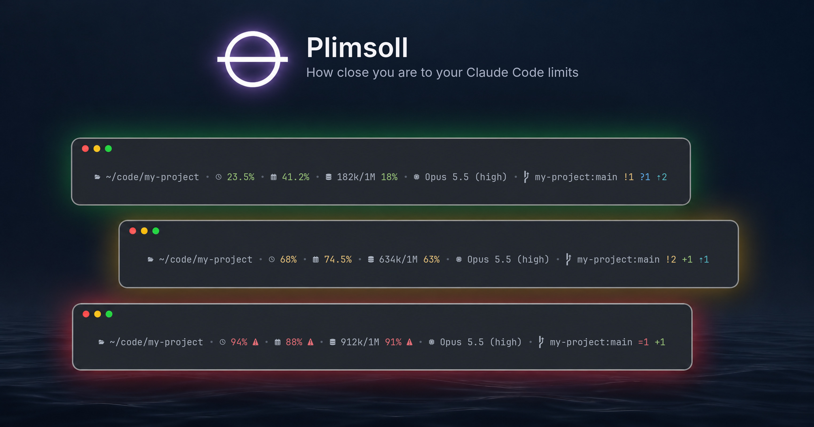
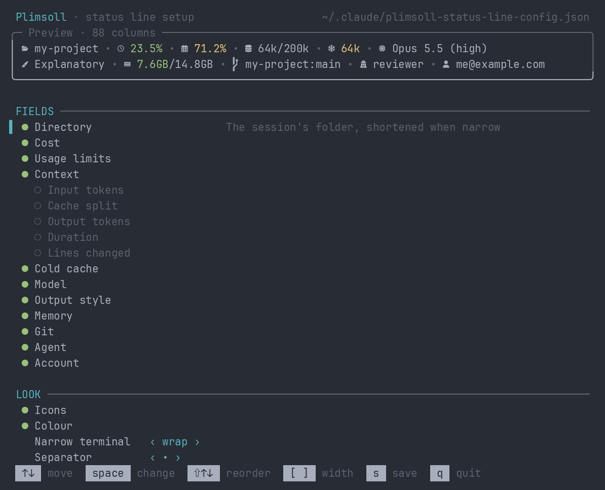
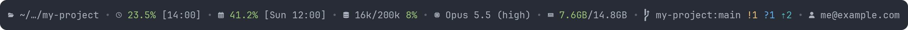
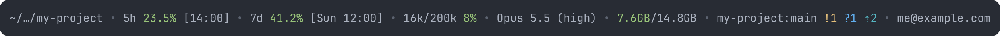
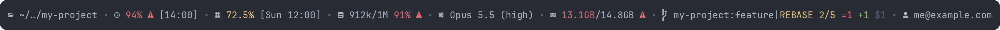
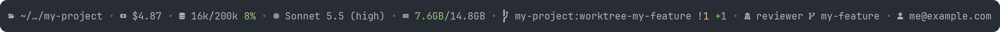
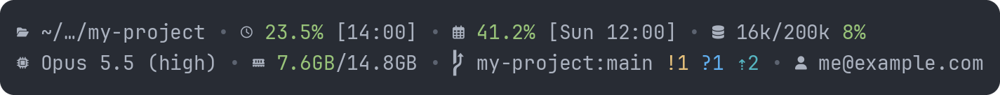

<p align="center">
  
</p>

<h1 align="center">Plimsoll</h1>

<p align="center">
  <strong>A Claude Code status line that shows how close you are to your limits.</strong>
</p>

<p align="center">
  <a href="https://github.com/joaotav/claude-code-statusline-plimsoll/actions/workflows/tests.yml"></a>
  
  
  
  <a href="LICENSE"></a>
</p>

<p align="center">
  <a href="#quick-start">Quick start</a> ·
  <a href="#fields">Fields</a> ·
  <a href="#configuration">Configuration</a> ·
  <a href="#faq">FAQ</a> ·
  <a href="#privacy">Privacy</a>
</p>

A Plimsoll line is the mark painted on a ship's hull that shows how heavily
it can be loaded. This one does the same for Claude Code: your 5-hour,
weekly and context limits sit at the front of the line, and turn yellow,
then red, as they fill up.

## Features

- **Limits at a glance.** The 5-hour and weekly usage, with the clock time
  each one resets, and how full the context window is. With an API key it
  shows the session's cost instead.
- **A warning before an expensive message.** Once the prompt cache has
  expired, it shows how many tokens your next message will cache again, at
  more than full price, so you can `/compact` or `/clear` first.
- **Fits the window.** On a narrow terminal the line wraps onto a second
  row, then sheds detail in a fixed order. Usage and context never drop.
- **Setup with a live preview.** Pick fields, icons, colour and order on
  one screen, and watch the line change as you go.
- **Nothing to install, nothing sent.** One Python file using only the
  standard library. No network calls, no credentials, one `git status`.

It also shows the directory, model and effort level, fast mode, output
style, git state, system memory, the agent and worktree, and the logged-in
account. Each field can be turned off or moved.

## Quick start

You need Linux or macOS, Python 3.8 or later and Claude Code v2.1.153 or
later. The icons need a [Nerd Font](https://www.nerdfonts.com); without one,
turn them off for the minimal line.

```sh
git clone https://github.com/joaotav/claude-code-statusline-plimsoll.git ~/claude-code-statusline-plimsoll
python3 ~/claude-code-statusline-plimsoll/scripts/setup.py
```

The setup screen opens with a live preview of the line. Choose what to
show, press `s` to save, and answer `y` when it offers to add the status
line to Claude Code. It appears straight away.



| Key | Does |
|---|---|
| `↑` `↓` | Move between settings |
| `Space`, `←` `→` | Change the selected setting |
| `Shift+↑` `Shift+↓` | Move the selected field along the line |
| `[` `]` | Narrow and widen the preview, to see how a smaller window looks |
| `s` | Save |
| `q` | Quit, asking first if anything changed |

Run it again whenever you want to change something. To update, `git pull`
in the clone. Your settings live outside it.

## Examples

**With icons, the default**



**Minimal, with icons off**



**Near the limits, in the middle of a rebase**



**With an API key, run with `--agent` in a worktree**



**Wrapped at 90 columns**



## Fields

| Field | Example | Shows |
|---|---|---|
| Directory | `~/…/my-project` | Where the session works |
| 5-hour limit | `5h 23.5% [19:45]` | Share used, and when it resets |
| Weekly limit | `7d 41.2% [Thu 14:00]` | Share used, and when it resets |
| Cost | `$1.23` | What the session has cost, with an API key only |
| Context | `477k/1M 48%` | How full the context window is |
| Cold cache | `cold 152k to rebuild` | Tokens the next message will send again, once the cache has expired and the context is big. Claude Code v2.1.251 or later |
| Model | `Opus 5.5 (high) fast` | Model and effort level, and `fast` (a bolt with icons) in fast mode |
| Output style | `style Explanatory` | The output style, when it isn't the default |
| Memory | `7.6GB/14.8GB` | System RAM in use, as `free -h` counts it |
| Git | `my-project:main !2 +1 ?1 ⇡2` | Repository, branch and changes |
| Agent | `agent reviewer worktree my-feature` | The `--agent` name and the worktree, when there is one |
| Account | `me@example.com` | Which account is logged in |

Percentages and memory turn yellow at 60% and red at 85%. From 85% they
also get a `⚠`, so the warning reads without colour too.

A value Claude Code hasn't sent yet is left out rather than shown as `0%`.
Reset times are clock times, because a countdown goes stale between
refreshes and `19:45` doesn't. The cost only shows without the 5-hour and
weekly limits: Claude Code prices every session at API rates, and that
figure is only a bill when you pay by API key.

<details>
<summary><strong>Git symbols</strong></summary>

<br>

The symbols match Starship and Powerlevel10k, and each one hides when its
count is zero.

| Symbol | Means | Colour |
|---|---|---|
| `=` | Conflicted | Red |
| `!` | Modified | Yellow |
| `+` | Staged | Green |
| `?` | Untracked | Blue |
| `✘` | Deleted | Red |
| `$` | Stashed | Dim |
| `⇡` | To push | Cyan |
| `⇣` | To pull | Magenta |

A detached HEAD shows as `@a1b2c3d`. During a rebase, merge, cherry-pick,
revert or bisect, the operation follows the branch in yellow, as in
`my-project:feature|REBASE 2/5 =1`. Inside a linked worktree the name is
still the main repository's.

</details>

## Configuration

The easiest way is the setup screen, `python3 scripts/setup.py`. It
writes `plimsoll-status-line-config.json` in Claude's config folder,
`~/.claude` or the folder `CLAUDE_CONFIG_DIR` names, and Claude Code picks
up the change at its next refresh.

You can also write that file by hand. List only the keys you change:

```json
{
  "icons": false,
  "show_account": false,
  "order": ["git"]
}
```

A missing or broken file leaves the defaults, and a key that's unknown or
has the wrong type is skipped, so a typo never blanks the line.
`NO_COLOR=1` in front of the `statusLine` command also turns colour off,
as for any program that follows [no-color.org](https://no-color.org).

### Settings

| Key | Default | Effect |
|---|---|---|
| `show_cwd`, `show_quota`, `show_cost`, `show_context`, `show_cache`, `show_model`, `show_output_style`, `show_memory`, `show_git`, `show_agent`, `show_account` | `true` | Each field |
| `show_input_tokens`, `show_cache_split`, `show_output_tokens`, `show_duration`, `show_lines_changed` | `false` | Extra detail, shown with the context |
| `icons` | `true` | Nerd Font icons. `false` gives the [minimal line](#icons-or-minimal) |
| `colour` | `true` | Colour |
| `warn_at`, `crit_at` | `60`, `85` | Percentages that turn yellow and red |
| `cold_cache_tokens` | `50000` | The smallest rebuild the cold cache field shows |
| `order` | `[]` | Field names in the order to show them. See [Field order](#field-order) |
| `separator` | `" • "` | Goes between fields, drawn dim |
| `max_lines` | `2` | `2` wraps, `1` drops. See [Narrow terminals](#narrow-terminals) |
| `git_timeout` | `0.5` | Seconds before a slow `git status` is abandoned |

The defaults live in `CONFIG` at the top of `statusline.py`. Change them in
your settings file instead, so `git pull` keeps working.

### Field order

`order` names fields by their `show_` key without the `show_`: `cwd`,
`cost`, `quota`, `context`, `cache`, `model`, `output_style`, `memory`,
`git`, `agent` and `account`, which is also the usual order. Fields you
leave out follow in that order, so `["git"]` moves git to the front and
keeps the rest as they were. Unknown names and repeats are skipped, and the
context extras stay with `context`.

### Icons or minimal

With icons off, the line is plain text with almost no labels, as in the
[minimal example](#examples). The two limits keep `5h` and `7d`, since two
bare percentages would look the same.

### Narrow terminals

| Mode | `max_lines` | On a narrow terminal | Choose it when |
|---|---|---|---|
| Wrap, the default | `2` | Fields move to a second line, in order. Nothing is lost until both lines are full | You want every field and can spare a row |
| Drop | `1` | Stays on one line and sheds detail, then fields | Vertical space matters more |

Dropping, at shrinking widths:

```
110 cols  my-project • 5h 23.5% • 7d 41.2% • 16k/200k • Opus 5.5 • 7.8GB/14.8GB • my-project:main • me@example.com
 71 cols  my-project • 5h 23.5% • 7d 41.2% • 16k/200k • Opus 5.5
 42 cols  5h 23.5% • 7d 41.2% • 16k/200k
```

<details>
<summary><strong>The order things are shed in</strong></summary>

<br>

Once there's no room left, both modes shed in the same order, wherever the
fields sit. Detail goes first:

1. The reset times, and "to rebuild" after a cold cache
2. The context percentage
3. The full path, leaving the folder name
4. The git symbols
5. The effort level and the fast mode badge

Then whole fields, in this order: account, output style, agent, memory,
git, model, cold cache and directory. The limits, cost and context always
stay, and widening the window brings everything back.

</details>

## FAQ

<details>
<summary><strong>What should I do when the line says the cache is cold?</strong></summary>

<br>

The cache expires after a while without a message, 5 minutes by default,
and the next one then caches the whole conversation again. Cache writes
cost 1.25 times the normal input price, or 2 times with the 1-hour cache,
against 0.1 times or less while the cache is warm. What to do depends
on whether you still need that conversation:

- **Same task, still need it:** just send. You pay once, and the cache is
  warm again.
- **Moving on to something new:** `/clear` first. A fresh conversation has
  nothing to rebuild.
- **Same task, but most of it is stale:** `/compact`. It costs about the
  same as a message this time, but every message after it is smaller.

It matters most when a limit is already yellow.

</details>

<details>
<summary><strong>The icons show as boxes or question marks</strong></summary>

<br>

Your terminal's font has no Nerd Font glyphs. Install one from
[nerdfonts.com](https://www.nerdfonts.com) and select it in your terminal,
or turn icons off in the setup screen.

</details>

<details>
<summary><strong>The usage limits don't show</strong></summary>

<br>

Claude Code only sends them to claude.ai subscribers, and only after the
session's first response. With an API key there are none, so the line shows
the session's cost instead.

</details>

<details>
<summary><strong>The status line doesn't appear</strong></summary>

<br>

Check that Claude Code is v2.1.153 or later, and that `settings.json` has
the `statusLine` block: `python3 scripts/install.py` adds it, or says it's
already there. To test the script on its own, render a sample:

```sh
python3 scripts/make-fixtures.py > /dev/null && ./statusline.py < fixtures/full.json
```

</details>

<details>
<summary><strong>I use several accounts with <code>CLAUDE_CONFIG_DIR</code></strong></summary>

<br>

Each config folder has its own `settings.json`, so install once for each:

```sh
CLAUDE_CONFIG_DIR=~/.claude-work python3 scripts/install.py
```

The settings file is shared: a folder without its own uses the one in
`~/.claude`. To give an account different settings, create an empty
`{}` file in its folder, then run the setup with the same
`CLAUDE_CONFIG_DIR`.

</details>

<details>
<summary><strong>Can I install it without the setup screen?</strong></summary>

<br>

`python3 scripts/install.py` adds the `statusLine` block to
`~/.claude/settings.json` and leaves your other settings alone. It backs
the file up first, and asks before replacing a status line that's already
there. Or add the block by hand, with the full path to the script:

```json
{
  "statusLine": {
    "type": "command",
    "command": "/home/you/claude-code-statusline-plimsoll/statusline.py",
    "padding": 0,
    "refreshInterval": 60
  }
}
```

`refreshInterval` keeps the numbers current while you're idle.

</details>

<details>
<summary><strong>How do I uninstall it?</strong></summary>

<br>

```sh
python3 scripts/install.py --uninstall
```

This removes the `statusLine` block, but only if it runs this script, and
backs up `settings.json` first. It then offers to delete your settings file
from the same folder. With `CLAUDE_CONFIG_DIR` it only touches that folder,
so a shared file in `~/.claude` stays for your other accounts. After that,
delete the clone.

</details>

## Privacy

The script stores nothing and sends nothing. There's no daemon, cache or
network call, and a render takes about 40 ms. It reads five things:

- The JSON Claude Code passes it, and never the transcript.
- One read-only `git status`, which never takes the index lock and gives up
  after 0.5 s. A few files under `.git` are also read, to spot a rebase or
  merge and count stashes.
- The account email from `.claude.json`, and nothing else in it. The login
  token is in a different file, which is never opened.
- The system memory totals, from `/proc/meminfo` or `vm_stat`.
- Your settings file, if you've made one.

The directory, repository, agent and email do show on screen. Turn those
fields off before sharing your screen.

## Development

```sh
python3 -m unittest discover -s tests -t .   # tests, Python 3.11+
./scripts/run-fixtures.sh                    # render every sample input
python3 scripts/make-screenshots.py          # README images, needs Pillow and a Nerd Font
python3 scripts/make-banner.py               # the banner, also needs Space Grotesk and Inter
python3 scripts/make-setup-gif.py            # the setup GIF, also needs tmux
```

The tests freeze the clock and stub git, and a few run real git and read
real memory. CI runs them on Linux and macOS with Python 3.11 and 3.14, and
renders every sample with Python 3.8.

## Acknowledgements

- [One Dark Triptych](https://statuslin.es/c/one-dark-triptych-071e85e2) by
  adrijshikhar, for spreading a status line over more than one line, dim
  separators, and reading memory natively on Linux and macOS.
- [Starship](https://starship.rs) and
  [Powerlevel10k](https://github.com/romkatv/powerlevel10k), for the git
  status symbols and colours.
- [claude-code-statusline](https://github.com/kcchien/claude-code-statusline)
  by kcchien, for the warning sign beside a critical value and for showing
  the agent and worktree.
- [Token Weather Usage](https://github.com/augiefra/claude-mods/tree/main/plugins/token-weather-usage)
  by augiefra, which was reviewed while deciding which fields deserve a
  place on the line.

## License

[MIT](LICENSE)
