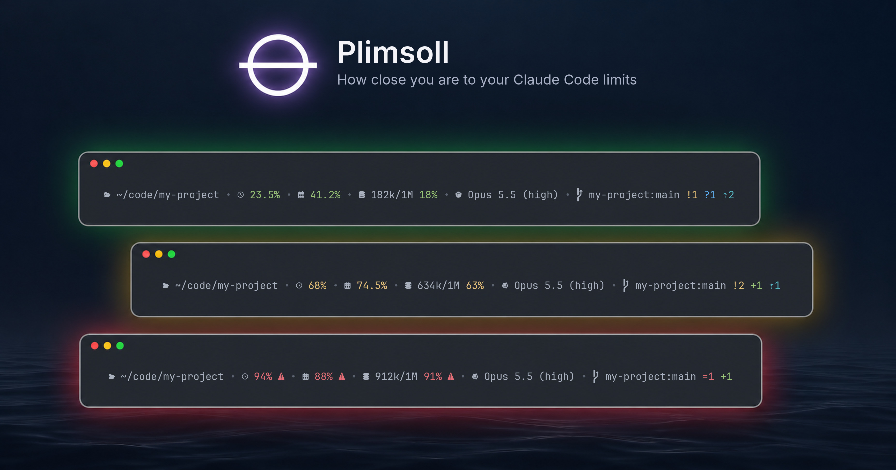
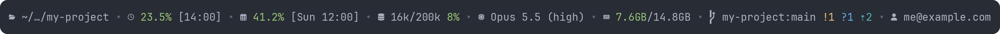
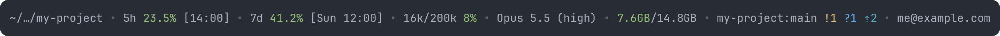
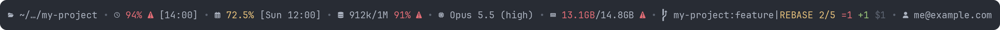
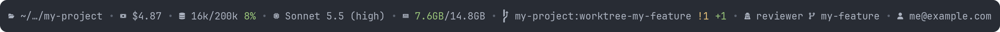
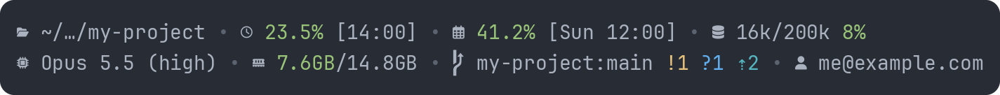

# Plimsoll - A configurable Claude Code status line

[](https://github.com/joaotav/claude-code-statusline-plimsoll/actions/workflows/tests.yml)


[](LICENSE)

A status line for Claude Code. It shows how close you are to your 5-hour,
weekly and context limits, along with the directory, model, effort level,
fast mode, system memory, git state, agent and worktree, and logged-in
account. With an API key it shows the session's cost instead of the limits.

It's named after the Plimsoll line, the mark painted on a ship's hull that
shows how heavily it can safely be loaded. Below the mark is safe, and past
it the ship is overloaded. This line does the same for Claude Code.

The line fits the terminal: on a narrow window it wraps, then sheds detail,
and usage and context are never dropped.

## Examples

**With icons (default):**



**Minimal (see [Icons or minimal](#icons-or-minimal)):**



**Near the limits, mid-rebase (see [Fields](#fields)):**



**With an API key, run with `--agent` in a worktree (see [Fields](#fields)):**



**Wrapped at 90 columns (see [Narrow terminals](#narrow-terminals)):**



## Fields

| Field | Example | Shows |
|---|---|---|
| Directory | `~/…/my-project` | Where the session works |
| 5-hour limit | `5h 23.5% [19:45]` | Share used, and when it resets |
| Weekly limit | `7d 41.2% [Thu 14:00]` | Share used, and when it resets |
| Cost | `$1.23` | What the session has cost, with an API key only |
| Context | `477k/1M 48%` | How full the context window is |
| Model | `Opus 5.5 (high) fast` | Model and effort level, and `fast` (a bolt with icons) in fast mode |
| Memory | `7.6GB/14.8GB` | System RAM in use, as `free -h` counts it |
| Git | `my-project:main !2 +1 ?1 ⇡2` | Repository, branch and changes |
| Agent | `agent reviewer worktree my-feature` | The `--agent` name and the worktree, only when there is one |
| Account | `me@example.com` | Which account is logged in |

The cost, agent and worktree show in the [API key example](#examples).

Percentages and memory turn yellow at 60% and red at 85%. From 85% they
also get a `⚠`, so the warning shows without colour too, as in the
[near the limits example](#examples).

The git symbols follow the same format as Starship and Powerlevel10k, and remain hidden when their count is zero.

| Symbol | Means | Colour |
|---|---|---|
| `=` | Conflicted | Red |
| `!` | Modified | Yellow |
| `+` | Staged | Green |
| `?` | Untracked | Blue |
| `✘` | Deleted | Red |
| `$` | Stashed | Dim |
| `⇡` | To push | Cyan |
| `⇣` | To pull | Magenta |

A detached HEAD shows as `@a1b2c3d`. During a rebase, merge, cherry-pick,
revert or bisect, the operation follows the branch in yellow, as in
`my-project:feature|REBASE 2/5 =1` and the
[near the limits example](#examples). Inside a linked worktree the name is
still the main repository's.

## Design choices

- **Missing means hidden.** An unknown value is left out instead of being
  shown as `0%`.
- **Reset times are clock times.** A countdown goes stale between refreshes,
  and `19:45` doesn't.
- **Cost only when it's a bill.** Claude Code prices every session at API
  rates, which is a bill only with an API key. The cost shows only for
  sessions without the 5-hour and weekly limits.

## Privacy

The script stores nothing and sends nothing: there's no daemon, cache or
network call, and a render takes about 40 ms. It reads four things:

- The JSON Claude Code passes it. It uses the directory, model, effort,
  agent, worktree, limits, cost, context size and fast mode, and never the
  transcript.
- One read-only `git status`. It never takes the index lock and gives up
  after 0.5 s. A few files under `.git` are also read, to spot a rebase or
  merge and count stashes.
- `.claude.json`, and only the account email in it. The login token is kept
  in a different file, which is never opened.
- The system memory totals, from `/proc/meminfo` or `vm_stat`.

It uses only Python's standard library. The directory, repository, agent
and email do show on screen, so turn off `show_cwd`, `show_git`, `show_agent`
and `show_account` before sharing your screen. `STATUSLINE_ACCOUNT=0` hides
the email without editing the script.

## Install

It runs on Linux and macOS, both tested in CI. Windows isn't supported.

You need Claude Code v2.1.153 or later and Python 3.8 or later. `git` is
only needed for the git field. The icons need a [Nerd Font](https://www.nerdfonts.com),
and without one you'll want the minimal line.

```sh
git clone https://github.com/joaotav/claude-code-statusline-plimsoll.git ~/claude-code-statusline-plimsoll
cd ~/claude-code-statusline-plimsoll
python3 scripts/make-fixtures.py > /dev/null && ./statusline.py < fixtures/full.json
```

The last line renders a sample so you can check it works. Then point Claude
Code at the script:

```sh
python3 scripts/install.py
```

This adds the `statusLine` block to `~/.claude/settings.json` and leaves your
other settings alone. It backs the file up first, and asks before replacing a
status line that's already there. If you use several accounts through
`CLAUDE_CONFIG_DIR`, each config folder has its own `settings.json`, so run
it once for each, as in
`CLAUDE_CONFIG_DIR=~/.claude-work python3 scripts/install.py`.

To add the block by hand instead, use the full path to the script:

```json
{
  "statusLine": {
    "type": "command",
    "command": "/home/you/claude-code-statusline-plimsoll/statusline.py",
    "padding": 0,
    "refreshInterval": 60
  }
}
```

`refreshInterval` keeps the numbers current while you're idle. To update,
run `git pull`.

## Configuration

### Environment variables

Put these in front of the `statusLine` command. They leave the script
untouched, so `git pull` keeps working.

| Variable | Effect |
|---|---|
| `STATUSLINE_ICONS=0` | The minimal line, as `icons: False` |
| `STATUSLINE_ACCOUNT=0` | No account email, as `show_account: False` |
| `NO_COLOR=1` | No colour, as `colour: False` |

For example, the minimal line without the account:

```json
"command": "STATUSLINE_ICONS=0 STATUSLINE_ACCOUNT=0 /home/you/claude-code-statusline-plimsoll/statusline.py"
```

### Settings in the script

Edit `CONFIG` at the top of `statusline.py`.

| Key | Default | Effect |
|---|---|---|
| `show_cwd`, `show_quota`, `show_cost`, `show_context`, `show_model`, `show_memory`, `show_git`, `show_agent`, `show_account` | `True` | Each field |
| `icons` | `True` | Nerd Font icons. `False` gives the minimal line |
| `colour` | `True` | Colour |
| `warn_at`, `crit_at` | `60`, `85` | Percentages that turn yellow and red |
| `separator` | `" • "` | Goes between fields, drawn dim |
| `max_lines` | `2` | `2` wraps, `1` drops. See [Narrow terminals](#narrow-terminals) |
| `git_timeout` | `0.5` | Seconds before a slow `git status` is abandoned |

`show_input_tokens`, `show_cache_split`, `show_output_tokens`,
`show_duration` and `show_lines_changed` also exist, and are off by default.

### Icons or minimal

Turn icons off for plain text with almost no labels, as in the
[minimal example](#examples). The two quotas keep `5h` and `7d`, since two
bare percentages would look the same.

### Narrow terminals

There are two ways to handle a narrow window, and one is chosen with
`max_lines`.

| Mode | `max_lines` | On a narrow terminal | Choose it when |
|---|---|---|---|
| Wrap, the default | `2` | Fields move to a second line, in order. Nothing is lost until both lines are full | You want every field and can spare a row |
| Drop | `1` | Stays on one line and sheds detail, then fields | Vertical space matters more |

Once there's no room left, both modes shed in the same order. The reset
times go first, then the context percentage, the full path, the git symbols,
and the effort level along with the fast mode badge. After that whole fields
go, starting with the account, then agent, memory, git, model and directory.
Quota, cost and context always stay, and widening the window brings
everything back.

The wrap at 90 columns is in the [examples](#examples). The drop, at
shrinking widths:

```
110 cols  my-project • 5h 23.5% • 7d 41.2% • 16k/200k • Opus 5.5 • 7.8GB/14.8GB • my-project:main • me@example.com
 71 cols  my-project • 5h 23.5% • 7d 41.2% • 16k/200k • Opus 5.5
 42 cols  5h 23.5% • 7d 41.2% • 16k/200k
```

## Development

```sh
python3 -m unittest discover -s tests -t .   # tests, Python 3.11+
./scripts/run-fixtures.sh                    # render every sample input
python3 scripts/make-screenshots.py          # README images, needs Pillow and a Nerd Font
python3 scripts/make-banner.py               # the banner, also needs Space Grotesk and Inter
```

The tests freeze the clock and stub git. Some run real git and read real
memory. CI runs them on Linux and macOS.

## Acknowledgements

The following projects served as inspiration for this mod:

- [One Dark Triptych](https://statuslin.es/c/one-dark-triptych-071e85e2) by
  adrijshikhar, for spreading a status line over more than one line, dim
  separators, and reading memory natively on Linux and macOS.
- [Starship](https://starship.rs) and
  [Powerlevel10k](https://github.com/romkatv/powerlevel10k), for the git
  status symbols and colours.
- [claude-code-statusline](https://github.com/kcchien/claude-code-statusline)
  by kcchien, for the warning sign beside a critical value and for showing
  the agent and worktree.
- [Token Weather Usage](https://github.com/augiefra/claude-mods/tree/main/plugins/token-weather-usage)
  by augiefra, which was reviewed while deciding which fields deserve a
  place on the line.

## License

MIT. See [LICENSE](LICENSE).
